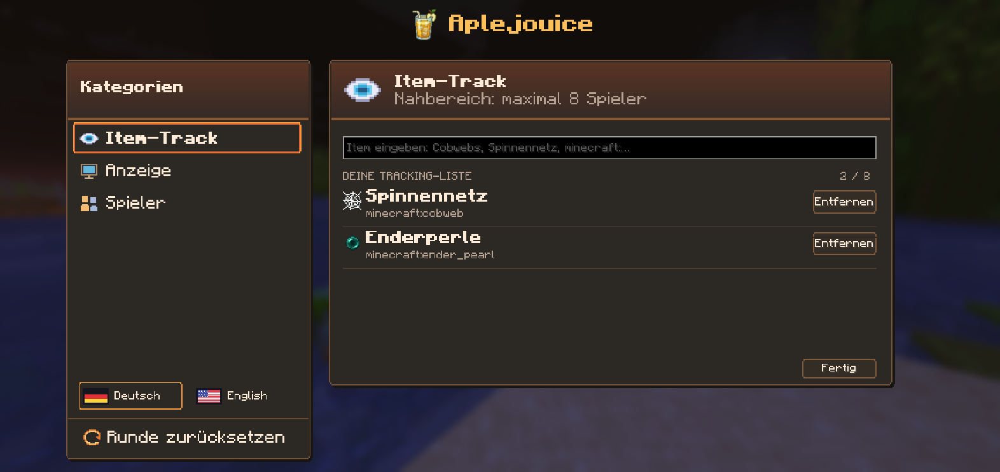
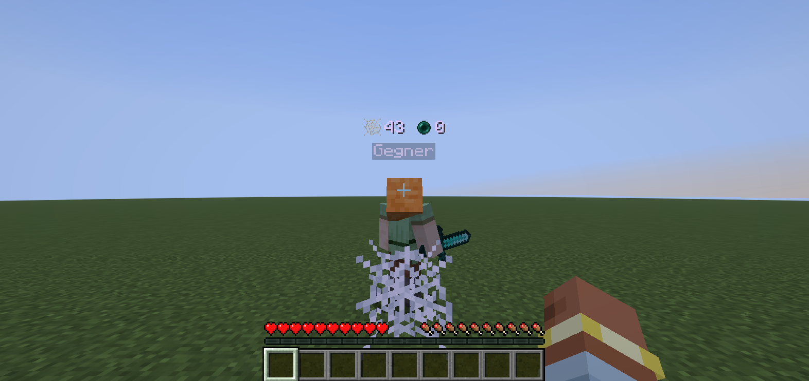

# Aplejouice Mod

A Fabric mod for Minecraft Java 1.21.11 that displays observed item-use counters above players. Press **J** to configure the watchlist and select an opponent. Client observation can be incomplete; an optional Fabric server companion supplies vanilla usage statistics.

Fabric-Mod für **Minecraft Java 1.21.11**, Java 21 und Fabric Loader ab 0.18.4.

## Updates (ab 1.7.0)

Beim Minecraft-Start wird einmal im Hintergrund `https://aplejouice.com/api/mod/latest?minecraft=1.21.11` abgefragt. Die Anfrage enthält die Minecraft-Version und die Mod-Version im User-Agent, keine Spielerkennung. Kurze Verbindungs-/Lese-Timeouts und eine Größenbegrenzung verhindern, dass ein Ausfall den Spielstart blockiert. Nur neuere stabile Versionen für dieselbe Minecraft-Version mit passender Mod-ID werden angeboten. Im Hauptmenü erscheint einmal pro Start ein Hinweis mit **Update herunterladen** und **Später**; falls die Antwort erst ingame eintrifft, erscheint einmal eine lokale Nachricht. Unter **Einstellungen → Downloads** bleibt die Downloadseite erreichbar. Es werden keine Dateien automatisch heruntergeladen oder ersetzt. Ältere Builds vor 1.7.0 bekommen den Prüfer erst durch manuelles Aktualisieren.

Neue Versionen werden über [GitHub Releases](https://github.com/jarogoated/aplejouice-mod/releases/new) veröffentlicht: Tag `v1.7.0`, dazu `Aplejouice-Mod-1.7.0-mc1.21.11.jar` (Versionsnummer entsprechend erhöhen). Die [Downloadseite](https://aplejouice.com/downloads) übernimmt veröffentlichte stabile Releases automatisch, spätestens nach etwa fünf Minuten Cache-Zeit. Entwürfe, Pre-Releases und andere Minecraft-Versionen werden nicht ausgewählt. Quellcode und Tag müssen zum gebauten JAR gehören. Der SHA-256-Wert der GitHub-Datei wird auf der Downloadseite angezeigt, sofern GitHub ihn bereitstellt.

## Koordinaten (1.7.1)

Unter **J → Koordinaten** eine eigene Kopiertaste wählen und **X**, **Y** sowie **Z** jeweils unabhängig ein- oder ausschalten. Alle Kombinationen sind möglich. Sind alle Achsen aus, wird nichts kopiert und die Zwischenablage bleibt unverändert. Die Taste ist anfangs unbelegt. Alternativ **Jetzt kopieren** benutzen. Kopiert werden die aktuellen Blockkoordinaten mit Leerzeichen, ohne Beschriftung und ohne Nachkommastellen, z. B. `111 47 -79`. Negative Positionen werden wie Minecraft abgerundet (`−0,1 → −1`). Der Tab zeigt eine laufende Vorschau; nach dem Kopieren erscheint kurz eine lokale Bestätigung über der Hotbar. Es wird keine Chatnachricht an den Server gesendet. Achsenauswahl und Taste bleiben nach Neustarts erhalten. Das Modul funktioniert unabhängig vom Item-Tracking.

## Willkommen (1.5.4)

Unter **Einstellungen / Settings** gibt es **Willkommenskarte erneut anzeigen** mit Wiederholen-Icon. Nach dem Schließen erscheint die Karte wieder ingame; beim nächsten Öffnen des Mod-Menüs wird sie erneut ausgeblendet. Kein erneuter Serverbeitritt nötig.

Ab 1.5.7 erscheint beim ersten Spielen oben rechts eine kompakte orange-goldene Willkommenskarte mit dem mitgelieferten, winkenden Skin und der aktuell belegten Menütaste. Ab 1.5.5 erscheint sie ausschließlich ingame bei sichtbarem HUD und geschlossenem Menü. Sie hat keinen Timeout. Sobald das Mod-Menü zum ersten Mal tatsächlich geöffnet wird, wird `welcomeSeen` gespeichert; danach bleibt die Karte auch nach Serverwechseln und Neustarts ausgeblendet. Deutsch/Englisch richtet sich nach der Mod-Sprache. Die Karte verändert den Spielerskin nicht. Sie ist auf 55 % der bisherigen Größe verkleinert und passt rechts neben die normale Bossbar. Bei sehr schmaler GUI wird sie unterhalb des Bossbar-Bereichs platziert.

## Hugo SMP Dual End Border (1.5.3)

Unter **J → Border** gibt es genau drei auswählbare Maps mit ihren jeweiligen Bildern: **Galaxy** (Plains), **Colloseum** (Wüste) und **Japan** (Cherry). Mit den Pfeilen blättern und mit **Wählen** aktivieren. Eine zusätzliche Vorschau zeigt **Kommt bald! / Coming Soon!** und ist nicht auswählbar. Die alten Namen und die unzugeordnete Border entfallen; gespeichertes `plains_tree` wird automatisch zu `galaxy`. Taste, Map und Schalter werden gespeichert; Taste zunächst unbelegt, Schalter zunächst aus. Die lila Border ist clientseitig, ohne Kollision, und innerhalb von 160 Blöcken sichtbar. Leichte Messabweichungen werden als Ellipsoid angenähert.

| Map | Seitliche Messpunkte (X Y Z) | Unten | Oben |
| --- | --- | --- | --- |
| Galaxy | 114 45 −80; 105 45 −71; 97 45 −80; 106 45 −89 | 106 37 −80 | 106 54 −80 |
| Colloseum | 112 51 −89; 120 51 −80; 111 51 −71; 103 51 −80 | 112 43 −80 | 112 60 −80 |
| Japan | 111 46 −70; 102 46 −79; 111 46 −87; 120 46 −79 | 111 38 −79 | 111 56 −79 |

Tab-Reihenfolge: **Item Track → Spieler → Visuals → Border → Koordinaten → Einstellungen** (Englisch: Players / Coordinates / Settings).

## Wasserquellen (1.5.2)

**J → Visuals → Wasserquellen hervorheben** markiert echte Wasser-Quellblöcke türkis an ihrer Oberfläche. Eigene Umschalttaste direkt im Tab oder in Minecrafts Steuerung festlegen. Standardmäßig aus, unabhängig vom Item-Tracking, Einstellungen gespeichert. Blockänderungen aktualisieren die Markierung sofort nach dem Eintreffen im Client. Bereits markierte Quellen werden zusätzlich jeden Tick auf Entfernung geprüft. Neue Quellen in geladenen Chunks werden mit bis zu 1536 Positionen pro Tick entdeckt, nahe Positionen zuerst. Radius 12, maximal 256 Quellen; kompletter Suchlauf ca. 0,25 s bei 20 TPS. Fließendes Wasser und wassergefüllte Blöcke sind ausgeschlossen. Solide Blöcke verdecken die Markierung; keine Chunks werden nachgeladen und keine Serverpakete gesendet.

## Installation

1. Fabric für Minecraft **1.21.11** installieren.
2. `Aplejouice Mod.jar` und **Fabric API für 1.21.11** in den `mods`-Ordner deiner Minecraft-Instanz legen.
3. Spiel starten, Welt oder Server betreten und **J** drücken. Die Taste kann in Minecraft unter Steuerung → Aplejouice Mod geändert werden.

Fabric: <https://fabricmc.net/use/installer/>

Fabric API: <https://modrinth.com/mod/fabric-api/versions?g=1.21.11>

Projekt und Download: [Aplejouice Mod auf Modrinth](https://modrinth.com/mod/aplejouice-mod). Die Beta 1.4.12 ist ungelistet zur Moderation eingereicht und vor der Freigabe möglicherweise nur für Projektmitglieder erreichbar. Für einen lokalen Build liegt die JAR nach `gradlew build` unter `build/libs/Aplejouice Mod.jar`.

Das Menü verwendet warme Orange-, Rot- und Goldtöne. Über allen Tabs steht zentral **Aplejouice Mod** mit dem Mod-Logo.

Die Screenshots zeigen frühere Entwicklungsstände; kleinere Details können von der aktuellen Version abweichen.





## Gegner-Modus und Leistung

Ab Version 1.4.4 ist **Nur ausgewählten Gegner tracken** standardmäßig **Aus**. Dann werden bis zu acht nahe Spieler beobachtet. Bereits gespeicherte Einstellungen bleiben erhalten. Wird die Option unter **Anzeige** eingeschaltet, ist nur der ausgewählte bzw. zuletzt angegriffene Spieler aktiv. Ohne Gegner gibt es keine zusätzlichen Item-Modelle, Bewegungshistorien oder Platzierungs-Auswertungen. Ein Angriff wählt einen Spieler aus; alternativ unter **Spieler → Wählen** manuell auswählen. **Ziel abwählen** stoppt das Tracking. Ein Angriff ist hier ein clientseitiger Angriffsversuch, keine Bestätigung des Schadens durch den Server.

Ab Version 1.4.12 ändert **Wählen** keinen Schalter mehr. Beim Einschalten des Gegner-Modus, nach einem Server-/Weltwechsel und nach erneutem Aktivieren des Hauptschalters wartet dieser Modus auf einen neuen Angriff oder eine manuelle Auswahl. Das bloße Laden eines Spielers oder Bots wählt ihn nicht aus. Im Nahbereich bekommt ein ausdrücklich ausgewählter Spieler innerhalb der eingestellten Reichweite Vorrang vor anderen Kandidaten, ohne die Grenze von acht Spielern zu erhöhen.

| Einstellung | Verhalten |
| --- | --- |
| Tracking aktiv: Aus | Keine Item-Anzeigen und kein Tracking. |
| Tracking aktiv: An, Gegner-Modus: Aus | Bis zu acht nahe Spieler anzeigen. |
| Tracking aktiv: An, Gegner-Modus: An | Erst nach Angriff oder Auswahl den gewählten Gegner anzeigen. |
| Nullwerte: An | Auch den Stand 0 bei den aktiven Spielern anzeigen. |
| Nullwerte: Aus | Nur Items mit mindestens einer erfassten Nutzung anzeigen. |

Unter **Anzeige → Nur ausgewählten Gegner tracken** kann der Gegner-Modus ein- und ausgeschaltet werden. Dann werden höchstens acht nahe Spieler innerhalb der eingestellten Sichtweite (maximal 64 Blöcke) beobachtet. Zur Vermeidung falscher Zuordnungen berücksichtigt der Gegner-Modus zusätzlich eine kleine, begrenzte Liste direkt benachbarter Spieler; Zähler und Badges erhalten nur die aktiven Ziele.

Ab Version 1.4.10 werden Item-Modelle höchstens einmal pro Sekunde pro Ziel neu aufgebaut und dazwischen wiederverwendet, statt in jedem Render-Durchlauf neu zu entstehen. Die Zahlen werden unabhängig davon aktualisiert. Bei ausgeblendeten Nullwerten werden ohne erfasste Nutzungen gar keine Item-Modelle erzeugt. Ressourcen-Neuladen, Serverwechsel und Änderungen an Tracking-Items oder Tracking-Modus verwerfen den Cache. Beobachter sind auf neun, unterschiedliche offene Platzierungs-Snapshots auf 128, offene Werfer-Snapshots auf 128, gespeicherte Spawn-IDs auf 2048 und gespeicherte Spielernamen/Zähler auf 64 begrenzt. Ab 1.4.11 zählen eindeutig zugeordnete Platzierungen sofort; identische offene Snapshots speichern die Anzahl ihrer Ereignisse zusammen, sodass eine schnelle Folge nicht mehr nach 128 Nutzungen abgeschnitten wird. Bei zu vielen unterschiedlichen offenen Snapshots wird der älteste mit den verfügbaren Informationen ausgewertet; weiterhin unklare Aktionen werden ausgelassen. Ältere Spawn-IDs und Spielernamen können aus dem Cache entfallen. Die Spielerauswahl listet alle derzeit geladenen, lebenden Gegner ohne Begrenzung auf 32 Einträge. Die Namensliste ist vom Tracking getrennt, lässt sich durchsuchen und mit dem Mausrad durchblättern. Sie wird nur bei geöffnetem Spieler-Tab einmal pro Sekunde aktualisiert; das Auflisten startet keine zusätzlichen Zähler oder Item-Modelle. Nicht geladene Spieler aus der serverweiten Tab-Liste werden nicht angezeigt.

Getestet wurde mit 100 künstlich geladenen Spielern im Fabric-Testclient, einschließlich Angriffsauswahl, Nullarbeit ohne Ziel, 100 Render-Auswertungen mit Modell-Wiederverwendung und den Obergrenzen. Das ist keine FPS-Messung oder Kompatibilitätsprüfung innerhalb des NoRisk Clients.

Die Auswahl der nächsten Beobachter sortiert ab 1.4.10 nicht mehr die gesamte Spielerliste, sondern hält nur die höchstens acht bzw. sieben nächsten Kandidaten vor. Abgerundete Menüflächen bündeln gleich breite Zeilen zu Rechtecken, statt pro Pixelzeile einen GUI-Zeichenauftrag zu erzeugen. Die neue Auswahl ist ohne Spielstart gegen 10.000 Kandidaten, Reichweitengrenzen und Gleichstände getestet. Für diesen Build wurde auf Wunsch keine Minecraft-Testinstanz gestartet; ein erneuter Join auf dem betroffenen Server ist noch zu prüfen.

## Bedienung

- **Item-Track:** Item suchen, beispielsweise `Cobwebs`, `Spinnennetz` oder `minecraft:cobweb`, und mit **+ Track** hinzufügen. Bis zu acht Items gleichzeitig. Leeres Suchfeld zeigt deine gespeicherte Liste. Mit dem Mausrad durch längere Listen blättern.
- **Anzeige:** Jede Einstellung hat ein eigenes Pixel-Icon (Power, Null-Zähler, Reichweite und Zielspieler). Tracking ein-/ausschalten, Nullwerte ausblenden, die Sichtweite ändern und zwischen Gegner-Modus und begrenztem Nahbereich wechseln.
- **Spieler:** Alle geladenen Gegner auflisten, nach ihrem Namen suchen und mit **Wählen** genau einen Gegner auswählen. Der aktive Gegner steht oben; mit einem Klick auf **Aktiv** wird er wieder abgewählt. Nur aktive Ziele erhalten Zähler. Die Suche unterscheidet nicht zwischen Groß- und Kleinschreibung.
- **Runde zurücksetzen:** Alle deine Zähler auf null setzen. Andere Spieler werden dadurch nicht zurückgesetzt.
- **Deutsch / English:** Unten links über die mitgelieferten Flaggen wechseln. Menütexte, Item-Namen und die Suche folgen der Mod-Sprache unabhängig von der Minecraft-Sprache. Die Auswahl bleibt nach dem Neustart erhalten.
- **Escape:** Menü schließen. J schließt ebenfalls, wenn du gerade nicht im Suchfeld schreibst.

Über den Köpfen aktiver Spieler erscheinen echte Item-Modelle und die Zahl ihrer erfassten Nutzungen, mittig in einer eigenen Zeile. Ab 1.4.12 werden diese unabhängig vom normalen Namensschriftzug extrahiert und eingereicht: Server-Teams oder andere Mods können den Vanilla-Namen ausblenden, ohne dadurch die Item-Anzeige abzuschalten. Text und Item-Modelle verwenden normale Tiefenprüfung. Unsichtbare Spieler und die eigene Figur sind ausgeschlossen; F1 blendet auch die Item-Anzeigen aus. Die Zahlen haben kein vorangestelltes Zeichen.

Einstellungen und Itemliste werden sofort nach jeder Änderung in `config/aplejuice-item-track.json` gespeichert und bleiben im selben Minecraft-Profil über Serverwechsel und Neustarts erhalten. Ab 1.4.12 schreibt die Mod über eine eindeutige temporäre Datei mit atomarem Ersetzen, soweit vom Dateisystem unterstützt. Eine `.bak`-Datei hält die vorherige gültige Version zur Wiederherstellung bei beschädigter Hauptdatei vor. Speicherfehler werden im Menü angezeigt, statt unbemerkt zu bleiben. Die Gegnerauswahl gehört nur zur aktuellen Welt/Sitzung und wird nicht als Einstellung gespeichert. Zähler gelten für die laufende Verbindung, bleiben bei Dimensionswechseln erhalten, werden bei einem beobachteten Tod dieses Spielers zurückgesetzt und werden beim Trennen vom Server gelöscht. Neu hinzugefügte Items beginnen bei null. Während Tracking ausgeschaltet ist, werden keine Nutzungen erfasst.

## Wie zuverlässig sind die Zahlen?

Ein empfangenes Death-Event setzt nur die Zähler dieses Spielers sofort zurück. Null-Lebenspunkte ohne Death-Event müssen mindestens fünf Client-Ticks anhalten. Nach einem Totem-Pop wird eine verzögert eintreffende Null-Health-Anzeige zunächst ignoriert, damit sie keine laufende Runde löscht. Bloßes Verlassen der Sichtweite gilt nicht als Tod. Nicht übertragene Tode außerhalb der geladenen Welt können nicht erkannt werden.

### Ohne Mod auf dem Server: Beobachtung

Die Mod funktioniert auch auf normalen Servern, aber der Client erhält keine vollständigen Nutzungsdaten anderer Spieler.

- **Platzierte Blöcke, einschließlich Cobwebs:** Live-Blockänderungen werden anhand von gehaltenem bzw. kürzlich gehaltenem Item, Entfernung (maximal sechs Blöcke) und Blickrichtung einem Spieler zugeordnet. Positionen, Kopfrotation und gehaltene Items werden beim Eingang des Block-Updates gesichert; kurze Bewegungs- und Hand-Historien überbrücken Paketversatz. Die Blickrichtung dient als Bewertung und verwirft bei einem eindeutig nahen Spieler keine Aktion. Schnelle Entfernen/Platzieren-Folgen an derselben Position werden einzeln gezählt. Bei mehreren ähnlich wahrscheinlichen Spielern wird die Aktion ausgelassen. Geladene Chunk-Inhalte werden nicht als neue Platzierungen gezählt.
- **Totems:** Jedes empfangene Status-35-Paket zählt sofort als eine Nutzung. Es gibt kein Limit auf einen Pop pro Tick. Ein Pop schützt gleichzeitig vor einem falschen Reset durch kurzzeitig gemeldete Null-Lebenspunkte.
- **Enderperlen und weitere Wurf-Items:** Perlen, Schneebälle, Erfahrungsfläschchen und Wurf-/Verweiltränke werden direkt beim Spawn-Paket erfasst, bevor das Projektil wieder verschwinden kann. Dieses Paket enthält die Entity-ID des Werfers. Fehlt dessen Spieler-Entity noch, wartet die Mod bis zu 20 Client-Ticks auf diese exakte ID; gleichartige Würfe desselben Werfers im selben Tick werden zusammen gespeichert. Unbekannte Besitzer werden nicht aus der Nähe geraten. Der frühere Acht-Block-Abstand verwirft keine vom bekannten aktiven Werfer empfangenen Spawns mehr. Dadurch kann auch eine früher geworfene Perle zählen, die erstmals in deinen geladenen Bereich gelangt. Die letzten 2048 Spawn-UUIDs werden gegen Doppelzählung gespeichert, auch über einen Runden-Reset hinweg.
- **End-Crystals:** Ein neues Crystal-Spawn-Paket über geladenem Obsidian oder Bedrock wird anhand von gehaltenem/kürzlich gehaltenem Crystal, Reichweite und Blickrichtung einem beobachteten Spieler zugeordnet. Die Erfassung wartet nicht auf einen Entity-Tick, sodass auch sofort zerstörte Crystals zählen können. Gleich wahrscheinliche Platzierer bleiben ungezählt. Der Spawn enthält keine Werfer-ID; bereits existierende oder serverseitig erzeugte Crystals lassen sich deshalb nicht in jeder Situation sicher von einer Spielerplatzierung unterscheiden. Die Spawn-UUID verhindert erneutes Zählen solange sie im Cache liegt.
- **Andere Items:** Aktionen ohne ein entsprechend beobachtbares Ereignis, beispielsweise Essen, benötigen weiterhin die optionale Server-Mod. Das Suchergebnis weist darauf hin.

Die Beobachtung umfasst die vom Server an deinen Client übertragenen Ereignisse der aktiven Ziele. Im Gegner-Modus werden andere Spieler nicht mitgezählt. Eine große Render-Distance erzwingt keine zusätzlichen Nutzungsdaten vom Server.

Die Beobachtungswerte werden auf Wunsch ohne **~** angezeigt; dadurch werden sie nicht zu vollständigen Server-Statistiken. Verpasste Aktionen, schnelle Wechsel des Hand-Items, Latenz, serverseitig erzeugte Blöcke und andere Servermechaniken können zu Abweichungen führen. Insbesondere bedeutet `0` nur „keine Nutzung erfasst“. Es ist kein verlässlicher Nachweis, dass nichts benutzt wurde.

### Mit Mod auf dem Server: Server-Sync

Dieselbe JAR und Fabric API können zusätzlich auf einem Fabric-Server installiert werden. Im Singleplayer ist der integrierte Server automatisch enthalten. Clients ohne diese Mod können weiterhin beitreten.

Der Server überträgt neue **Vanilla-Statistikereignisse `ITEM_USED`** in derselben Dimension und innerhalb von 128 Blöcken. Der Client verwendet diese Server-Ereignisse statt der Beobachtung, damit Aktionen nicht doppelt zählen. Die Zählung beginnt ab Verbindung bzw. dem letzten lokalen Reset, nicht bei den lebenslangen Statistiken. Die Vanilla-Definition entscheidet, was als „benutzt“ gilt: etwa platzierte Blöcke, geworfene Perlen, gegessene Äpfel oder Werkzeugnutzungen. Ein vom Client beobachteter Tod setzt die Werte des Spielers auch im Server-Modus zurück. Aktionen ohne `ITEM_USED`-Ereignis sowie Nutzungen außerhalb der Übertragungsreichweite werden nicht erfasst.

## Versionen

Dieser Build unterstützt **1.21.11**. Minecraft 26.1 und höher benötigen einen separaten Port/Build. Die verwendeten offiziellen Mojang-Mappings erleichtern einen späteren Port; die Versionsprüfung ist absichtlich auf die tatsächlich unterstützte Version begrenzt.

## Entwickeln und prüfen

```powershell
.\gradlew.bat build
.\gradlew.bat runClientGameTest
.\gradlew.bat runClientGameTest -PuiOnly
.\gradlew.bat runClient
```

`build` kompiliert und remappt die Mod und führt Tests ohne Spielstart aus: Zähler, Auswahl aus 10.000 Kandidaten, 4096 Nutzungen mit einem Snapshot, 700 unterschiedliche Snapshot-Gruppen, Totem-/Null-Health-Schutz sowie ab 1.4.12 Einstellungen mit Datei-Roundtrips/Wiederherstellung, sessionbezogene Zielauswahl, Moduswechsel und Nullwert-/Sichtbarkeitsregeln. `compileGametestJava` kompiliert zusätzlich die Integrationstests ohne Minecraft zu starten. Diese beiden Prüfungen wurden für 1.4.12 ausgeführt (20 Unit-Tests erfolgreich).

`runClientGameTest` würde einen separaten Minecraft-Testclient starten. Die erweiterten Integrationstests enthalten unter anderem 100 Pops, 700 Web-Platzierungen, 256 sofort verschwindende Perlen, 256 Würfe vor dem Laden ihres Werfers, 64 Crystal-Platzierungen auf Obsidian/Bedrock, doppelte Spawn-Pakete sowie Tod/Respawn. Weitere Fälle prüfen verborgene Vanilla-Namen, unabhängige Badge-Anker, Nullwerte, manuelle Auswahl ohne Moduswechsel und das Beibehalten von Einstellungen beim Zurücksetzen der Verbindung. Diese erweiterten Tests wurden für 1.4.12 auf Wunsch nicht ausgeführt; eine visuelle Prüfung im NoRisk Client steht aus. Der bestehende Lobby-Test umfasst 100 geladene Spieler, Angriffs-/Menüauswahl, Modell-Cache und Tracking-Obergrenzen. Screenshots liegen nach einem solchen Lauf in `build/run/clientGameTest/screenshots`. Die Test-Mod wird nicht in die veröffentlichte JAR gepackt. Tests verwenden eine temporäre Singleplayer-Welt und verändern keine vorhandene Minecraft-Installation.

Quellcode: `src/main` enthält Server-Sync und Zähler, `src/client` enthält Menü, Beobachtung und Namens-Badges. Die linke Navigation lässt sich für weitere Module erweitern.

## Lizenz und KI-Hinweis

Der Quellcode steht unter der [MIT-Lizenz](LICENSE). Der überwiegende Teil des Codes wurde mit OpenAI Codex anhand der Anforderungen und Rückmeldungen des Projektinhabers erstellt. Auch UI-Texte, Übersetzungen und die programmatisch gezeichneten Pixel-Icons wurden mit KI-Unterstützung erstellt. Die Mod selbst verwendet zur Laufzeit keine generative KI. Auf Modrinth ist das Projekt entsprechend gekennzeichnet und als ungelistetes Projekt eingereicht.

Die Pixel-Icons lassen sich ohne Bildbearbeitung deterministisch neu backen: `java tools/BakeIcons.java src/client/resources/assets/aplejuice/textures/gui`. Jedes Icon wird als eine Textur mit transparentem Hintergrund und festem Seitenverhältnis gerendert; so entstehen keine Nähte zwischen einzeln skalierten Pixeln.
